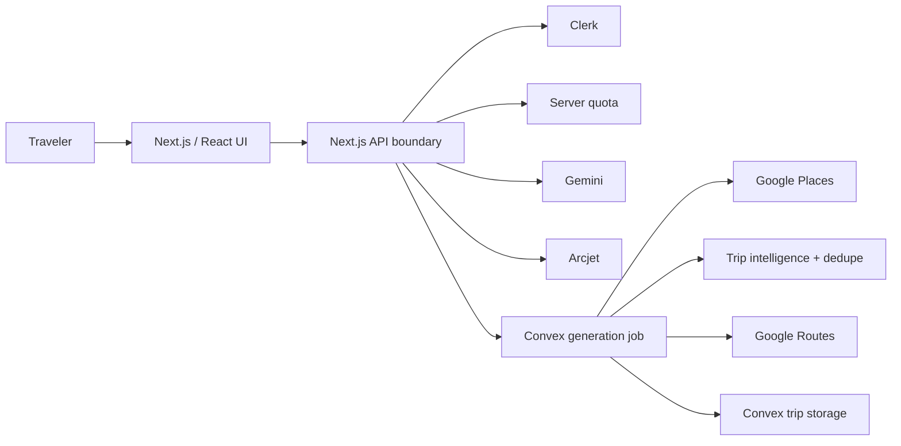

# Trip Planner

**AI-assisted travel planning that turns a natural-language trip idea into a practical, personalized itinerary.**

[](https://github.com/mayank-kumar111/trip_planner-master/actions/workflows/ci.yml) [](https://www.typescriptlang.org/) [](https://nextjs.org/) [](https://react.dev/) [](https://www.convex.dev/) [](https://clerk.com/)

> **Release position:** controlled-beta ready subject to production configuration and deployed smoke evidence. Aggressive scale remains **NO-GO** until background execution is durable and provider caching is shared/distributed.

## Product in plain language
A traveler describes a trip conversationally. The application asks only for missing information, generates a structured candidate itinerary, verifies/enriches places with Google Places, optionally calculates routes, and saves the trip for later review.

The responsibility split is deliberate: **Gemini proposes**, **Google Places verifies geographic facts**, **Google Routes calculates driving routes**, **Convex persists state**, **Clerk authenticates**, and **Arcjet protects expensive request boundaries**.

## Architecture


Generation flow: `Conversation → AI → runtime validation → raw trip/job → claim → Places → dedupe → intelligence → optional routes → final persistence → completed job`.

The reusable background service is separate from the HTTP boundary. Convex durably schedules a secured Next.js worker, and a periodic Convex watchdog re-queues stale jobs. The worker still runs inside the Next.js runtime; moving execution to a dedicated worker service remains a later scale step.

## Technology stack
| Layer | Technology | Role |
|---|---|---|
| Web | Next.js 15 + React 19 | UI and server routes |
| Language | TypeScript 5 | typed application code |
| Styling | Tailwind CSS 4 | UI styling |
| Auth | Clerk | authentication/identity |
| Backend | Convex | persistent state/functions |
| AI | Google Gemini Developer API | trip candidate generation |
| Places | Google Maps Platform Places API (New) | factual place enrichment |
| Routing | Google Maps Platform Routes API | driving routes |
| Security | Arcjet | abuse/rate protection |
| HTTP | Axios | provider requests |
| Testing | Node test runner + TS path loader | regression suite |

## Quick start
Requirements: Node.js 22 recommended, npm, and valid local service credentials.

```bash
npm ci
cp .env.example .env.local
npm run dev
```

Open `http://localhost:3000`.

Production-like local validation:
```bash
npm run build
npm start
```

## Environment
`.env.example` is the sanitized environment contract. Required integration groups are Convex, Clerk, Gemini, Arcjet, Google Places, and Google Routes when route enrichment is enabled. Browser maps are optional.

```env
NEXT_PUBLIC_ENABLE_GOOGLE_MAPS=false
NEXT_PUBLIC_GOOGLE_MAPS_API_KEY=
NEXT_PUBLIC_GOOGLE_MAP_ID=
```

Server secrets must never be committed. Documentation examples use `<INSERT_PRODUCTION_KEY_HERE>`.

## Engineering invariants
- **Dates:** explicit start/end dates are authoritative; inclusive duration is derived when both exist; itinerary dates must be consecutive.
- **Security:** authorization and quota are server-owned; stable Clerk identity is preferred; legacy email fallback exists only for old records.
- **Places:** AI names are candidates until provider enrichment; canonical `place_id` is preferred for deduplication.
- **Jobs:** persistent generation jobs track lifecycle, timing, retryability, and provider metrics; fresh jobs are atomically claimed.
- **Cost:** provider calls use bounded caches, in-flight dedupe, timeouts/concurrency controls, and route batching where possible.

## Quality gate
Run the same checks expected by CI:
```bash
npm ci
npm run docs:check
npm run audit
npm run typecheck
npm test
npm run build
```

## Documentation map
- **Non-technical/product:** `docs/PRODUCT_GUIDE.md` → `docs/guides/USER_ADMIN_GUIDE.md`
- **Developer:** `docs/DEVELOPER_GUIDE.md` → `docs/guides/DEVELOPER_ONBOARDING.md` → `docs/architecture/`
- **API/QA:** `docs/API_SPECIFICATION.md` → `docs/API_REFERENCE.md`
- **Security:** `docs/SECURITY.md`
- **Operations:** `docs/ops/DEPLOYMENT.md` → `docs/ops/ENVIRONMENT_VARIABLES.md` → `docs/ops/RUNBOOK.md`
- **Launch:** `docs/BETA_LAUNCH_GATE.md` → `docs/RELEASE_CHECKLIST.md`
- **Configuration/manifests:** `docs/CONFIGURATION_REGISTRY.md` → `docs/MANIFEST_REGISTRY.md`
- **Folder coverage:** `docs/folder_guides/README.md`

## Repository structure
```text
app/                 # Next.js pages, UI and API boundaries
components/           # shared UI primitives
context/              # shared client context
convex/               # schema, persistence and backend functions
hooks/                # reusable client hooks
lib/                  # domain, provider, security and pipeline logic
tests/                # regression tests
docs/                 # product, architecture, API, security and ops docs
public/               # static browser assets
.github/workflows/     # CI quality gate
.env.example          # sanitized environment contract
package.json           # scripts/dependencies
```

Every meaningful source directory is expected to contain a local README. Generated `convex/_generated/` files are documented but must not be manually edited.

## Launch position
The stabilization assessment is **80/100 (B+)**. Controlled beta is the current target, subject to production configuration and deployed smoke evidence. Aggressive scale remains blocked by worker execution inside the Next.js runtime, process-local provider caches, and the need for real production SLO evidence.

Release sequence: `change → docs check → audit → typecheck → tests → build → exact-commit CI → production config → deployed smoke test → controlled beta`.

Never commit production secrets. If a secret is exposed, rotate it immediately and treat the value as compromised.
