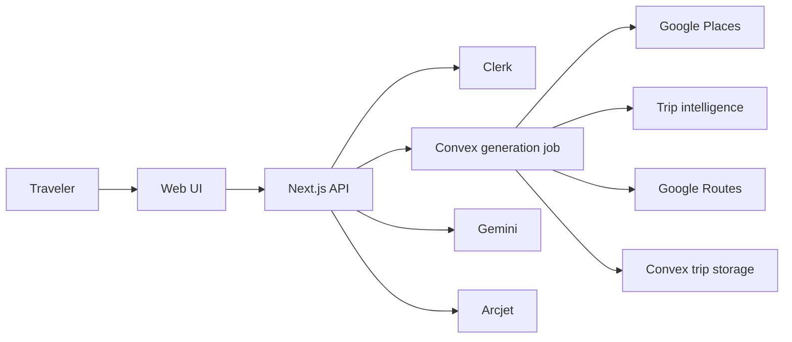

# Trip Planner Documentation

## Executive view
This folder is the product and engineering operating manual. It is written in two layers: plain-language guidance for non-technical readers and technical detail for developers, QA, security, and operations.

## Documentation map
| Area | Canonical document | Audience |
|---|---|---|
| Product | `PRODUCT_GUIDE.md` | product/non-technical |
| Setup | `GETTING_STARTED.md` | everyone |
| Development | `DEVELOPER_GUIDE.md` | developers |
| Architecture | `architecture/` + `ARCHITECTURE.md` | developers/architects |
| API | `API_SPECIFICATION.md` + `API_REFERENCE.md` | backend/QA |
| Data | `DATA_MODEL.md` | backend/data reviewers |
| Security | `SECURITY.md` | developers/security |
| Testing | `TESTING.md` | QA/release |
| Operations | `ops/` | deployment/operators |
| Guides | `guides/` | developers/users/admins |
| Launch | `BETA_LAUNCH_GATE.md` + `RELEASE_CHECKLIST.md` | release owners |
| Assessment | `STARTUP_GRADER.md` | founders/reviewers |
| Configuration | `CONFIGURATION_REGISTRY.md` + `MANIFEST_REGISTRY.md` | platform/reviewers |
| Folder coverage | `folder_guides/README.md` | all maintainers |

## Read by goal
- **Understand the product:** `PRODUCT_GUIDE.md` → `guides/USER_ADMIN_GUIDE.md`
- **Start coding:** `GETTING_STARTED.md` → `guides/DEVELOPER_ONBOARDING.md` → `architecture/`
- **Review APIs:** `API_SPECIFICATION.md` → `API_REFERENCE.md`
- **Deploy/operate:** `ops/DEPLOYMENT.md` → `ops/ENVIRONMENT_VARIABLES.md` → `ops/RUNBOOK.md`
- **Security review:** `SECURITY.md`
- **Launch decision:** `BETA_LAUNCH_GATE.md`

## Architecture at a glance

## Documentation rules
- Describe the current repository, not an aspirational implementation.
- Mark limitations and non-goals explicitly.
- Never commit or document real secrets; use `<INSERT_PRODUCTION_KEY_HERE>` for examples.
- New meaningful source directories should receive a local `README.md`.
- New manifests/configuration surfaces must be added to the registries.
- Generated `convex/_generated` files are documented but never hand-edited.

## Evidence snapshot
The current engineering assessment is 80/100 (B+), with controlled beta permitted subject to production configuration and deployed smoke evidence. The code release candidate previously verified was `9503d217bd224d1b0b51a1442f071cb4c0460877`, with 31/31 tests, passing typecheck/build, and CI #210 success. Documentation commits after that evidence snapshot must be re-verified before release.

## Scale boundary
Aggressive scale remains NO-GO until worker execution is moved out of the Next.js runtime, provider caches are shared/distributed, and production SLO evidence exists.
