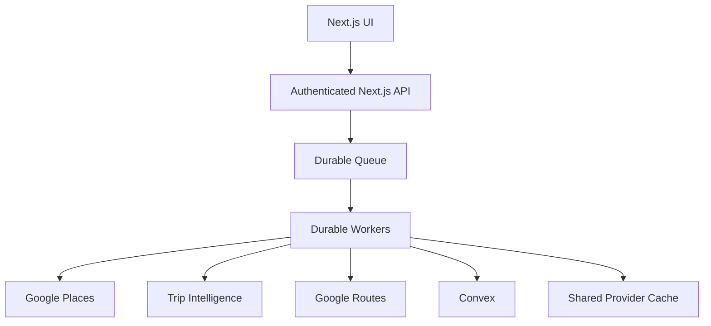

# Trip Planner — Startup / Engineering Readiness Assessment

## Executive summary

Trip Planner is a conversational AI travel-planning application. The system turns natural-language trip requirements into a structured itinerary, verifies real places through Google Places, optionally enriches routes, persists trip state in Convex, and protects authenticated/provider operations with Clerk and Arcjet.

**Current release position:** suitable for a **controlled beta**, not for aggressive scale.

The latest verified release is `fc7c132`. Local verification recorded **37/37 tests passing**, successful TypeScript checking, a successful production build with **17/17 static pages**, and GitHub Actions CI **#9** succeeding for that exact commit.

The score below is an engineering-readiness assessment, not a claim that production SLOs have already been achieved.

## Technical deep dive

### Scorecard

| Category | Baseline | Current | Evidence / remaining risk |
|---|---:|---:|---|
| Product value & differentiation | 14/20 | 14/20 | Conversational planning + verified places + route intelligence; no material product-scope change in stabilization work |
| Architecture & code organization | 13/20 | 17/20 | Persistent generation jobs, thin process API, reusable pipeline, routing service and background-processing service; durable queue remains missing |
| Engineering quality | 12/20 | 17/20 | Runtime validation, typed boundaries, regression coverage, typecheck/build CI gates and failure-path tests; test-runner warnings remain |
| Security & abuse resistance | 13/20 | 15/20 | Clerk auth/ownership, Arcjet protection, bounded request payloads and provider endpoint hardening; broader production abuse/load testing remains limited |
| Scalability & unit economics | 8/15 | 10/15 | Provider batching, bounded TTL caches, in-flight dedupe and concurrency caps; caches are process-local and the secured worker still executes inside the Next.js runtime |
| Launch / growth readiness | 7/15 | 7/15 | Recovery, observability and CI improved; production SLO measurements and durable workers remain open |
| **Total** | **67/100** | **80/100** | **Controlled-beta ready; scale work remains** |

### Release decision

- **Controlled beta:** GO after deployed configuration and smoke-test verification.
- **Aggressive scale:** NO-GO until durable background execution and shared provider caching are implemented and production SLO evidence exists.

## Major engineering controls

### AI quota

- Server owns final-generation quota reservation/confirmation/release.
- Reservation accounting is numeric and atomic.
- Reservation records expire and can be cleaned up safely.
- Client code does not decide whether a generation consumed quota.

### Authentication and ownership

- Clerk is the authentication boundary.
- Stable Clerk user ID is the canonical current ownership identity.
- Legacy email fallback remains only for compatibility with older records.
- Protected operations verify ownership server-side.

### Runtime validation

`lib/trip/validation.ts` validates:

- required trip fields;
- bounded text;
- `YYYY-MM-DD` dates;
- start/end ordering;
- duration consistency;
- consecutive itinerary days/dates;
- coordinate ranges;
- hotel ratings;
- collection limits;
- required hotel/activity fields.

`lib/trip/date-rules.ts` makes explicit selected start/end dates authoritative and derives inclusive duration when appropriate.

### Provider cost controls

Places:

- 10-minute TTL;
- maximum 500 entries;
- normalized lookup keys;
- in-flight promise deduplication;
- maximum three concurrent lookups.

Routes:

- bounded TTL cache;
- maximum 500 entries;
- in-flight deduplication;
- 8-second timeout;
- four-request global provider concurrency cap;
- day-level route sequence batching where coordinates are contiguous.

Canonical Google place IDs are preferred for identity, with normalized name/address fallback where necessary. Trip-wide deduplication reduces repeated representations of the same place.

### Generation reliability

The current lifecycle is:

```text
User intent
  ↓
Authenticated AI request
  ↓
Quota reservation
  ↓
Gemini generation
  ↓
Runtime validation
  ↓
Raw trip persistence
  ↓
Persistent TripGenerationJob
  ↓
Claim / duplicate protection
  ↓
Background pipeline
  ↓
Places + dedupe + intelligence
  ↓
Routes when enabled
  ↓
Final persistence
  ↓
Completed job
```

Failed/stale jobs have recovery-aware state and a retry path.

### Remaining architectural risk

The reusable processing code is separated from the HTTP boundary. Convex durably schedules the secured worker and stale recovery can re-queue jobs, while the worker itself still executes inside the Next.js runtime. A process termination can interrupt an active attempt, with persistent job state and lease recovery providing the recovery path.

The provider caches are also process-local. Multiple application instances do not share those caches.

## Testing and CI evidence

Latest verified local results for `fc7c132`:

```text
npm run audit       PASS
npm run typecheck   PASS
npm test            37/37 PASS
npm run build       PASS — 17/17 static pages
```

GitHub Actions CI #9 for `fc7c132` completed successfully. The CI workflow runs:

```text
Node 22
  ↓
npm ci
  ↓
npm run audit
  ↓
npm run typecheck
  ↓
npm test
  ↓
npm run build
```

## Production metrics still required

The following are targets, not measured production results:

| Metric | Target | Current evidence |
|---|---:|---|
| Generation success rate | ≥98% | Regression coverage; production measurement pending |
| First visible result | <5 sec | Architecture supports early raw persistence; production measurement pending |
| Complete trip median | <30 sec | Batching/concurrency controls; production measurement pending |
| Provider failure rate | <2% | Failure counters/tests; production measurement pending |
| Quota reconciliation errors | 0 | Atomic lifecycle; production reconciliation pending |
| Duplicate Places lookups | <10% | Canonical identity/dedupe; production ratio pending |
| Trip save success | ≥99% | Regression-covered save pipeline; production measurement pending |
| Crash-free generation sessions | ≥99% | Not measurable from repository tests alone |

## Stabilization program status

1. AI quota stabilization — **complete**.
2. Provider API security — **complete**.
3. Runtime validation — **complete**.
4. Date correctness — **complete** for explicit start/end source-of-truth rules.
5. Provider cost controls — **complete for controlled-beta architecture**.
6. Long-work decoupling — **implemented with persistent jobs and reusable background pipeline; durable queue remains open**.
7. Generation/enrichment refactor — **complete for the main path**.
8. Testing and CI — **complete for current repository scope**.
9. Observability — **implemented; production aggregation/dashboarding remains open**.
10. Beta launch gate — **controlled-beta GO after deployed verification**.

## Recommended scale architecture



The repository is intentionally being documented as it exists today rather than presenting this future architecture as already implemented.

## Re-grading rule

Do not increase the score solely because documentation becomes more comprehensive. The next material score increase should require production-like SLO measurements, stronger operational evidence, durable worker execution, and/or shared provider caching.
