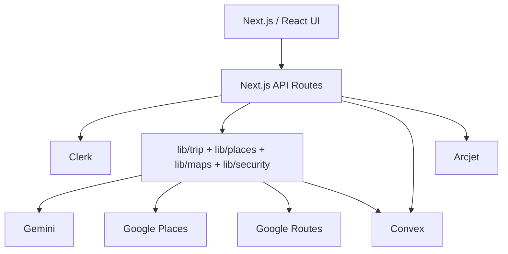

# C4 Container View

## Executive view
The system is split into a browser experience, Next.js server boundary, reusable domain services, Convex persistence, and external providers.

## Major containers/modules
| Container | Inputs | Outputs | Key dependencies |
|---|---|---|---|
| React/Next UI | traveler actions, persisted trip state | forms, progress, itinerary views | Clerk, Convex client |
| API routes | HTTP requests | validated HTTP responses | Clerk, Arcjet, domain modules |
| AI generation | conversation/context | structured raw plan | Gemini, quota mutations |
| Background processor | claimed trip/job | enriched/routed persisted trip | Places, intelligence, Routes, Convex |
| Trip domain | plans, dates, places | validated/optimized plans | date rules, validation, identity |
| Places domain | place candidates | factual place data | Google Places, cache |
| Maps domain | coordinates | route metadata | Google Routes, cache/concurrency |
| Convex backend | authenticated mutations/queries | durable state | Convex database |

## Persistence boundary
The `TripGenerationJobTable` is the durable coordination record for generation lifecycle, status, retryability, timing, and provider metrics. Trip data is persisted separately and remains owner-scoped.

## Scale boundary
Current background execution is durably scheduled through Convex to a secured Next.js worker around a reusable service. The worker still runs inside the Next.js runtime, and provider caches are process-local. These are explicit pre-scale architectural constraints.
