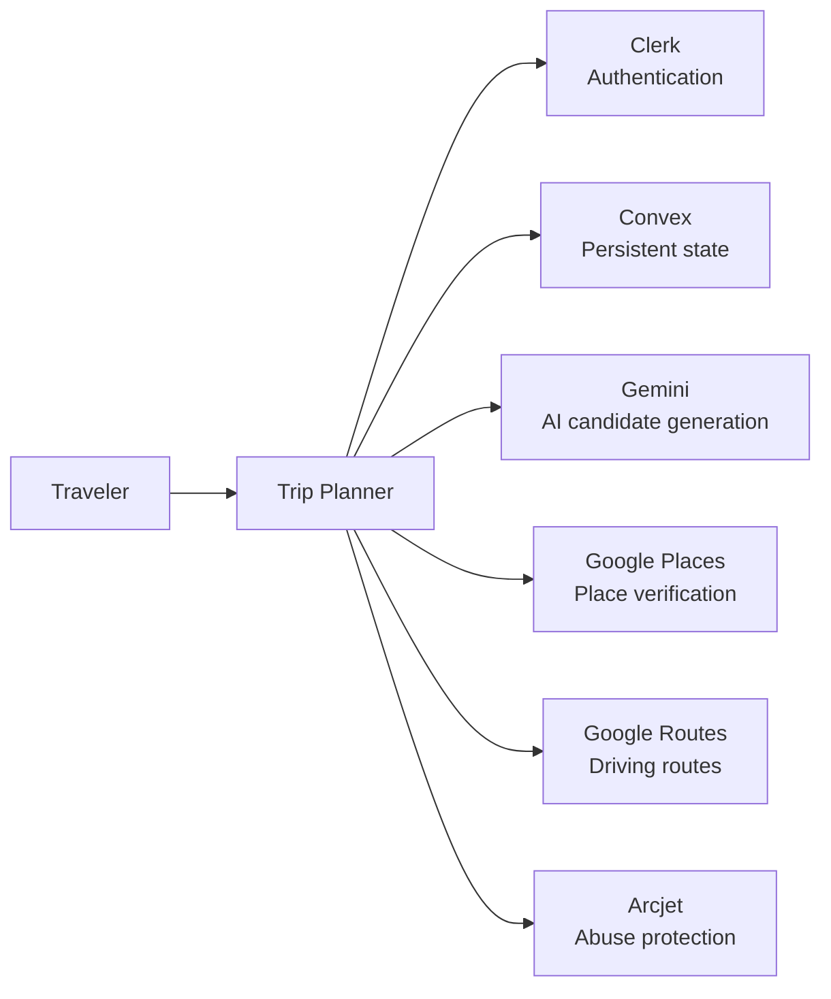

# C4 Context

## Executive view
A traveler interacts with Trip Planner. Trip Planner coordinates authentication, AI generation, geographic enrichment, routing, and persistent trip storage through managed services.

## Context diagram

## Responsibilities
| System | Responsibility |
|---|---|
| Traveler | supplies trip intent and reviews results |
| Trip Planner | validates, orchestrates, persists, and presents trips |
| Clerk | authentication and stable identity |
| Convex | user/trip/job persistence and server functions |
| Gemini | natural-language trip candidate generation |
| Google Places | factual place identity and location data |
| Google Routes | route calculation |
| Arcjet | request protection/rate controls |

## Security boundary
The browser is outside the trusted application boundary. Provider credentials and authorization decisions remain server-side.
