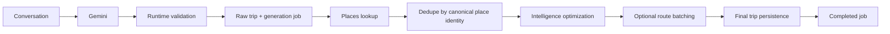
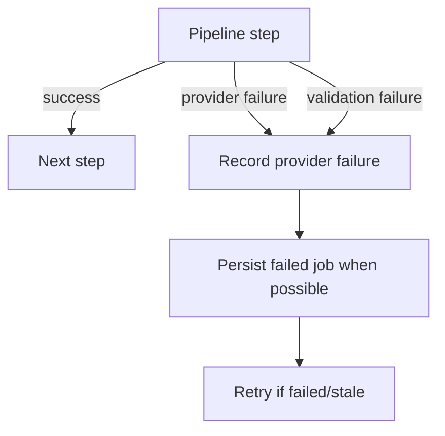

# Data Flow, Storage, State, and Cache

## Executive view
A trip moves from conversation → AI candidate → validated raw plan → persistent job → provider enrichment → optimization → optional routing → final persistence.



## Persistent state
The generation job lifecycle is:

```text
generated → enriching → enriched → routing → completed
                         └──────────────→ failed
```

Failed or stale work can enter the retry path. Claim logic prevents multiple fresh processors from owning the same job.

## Data ownership
- User identity is derived server-side from Clerk.
- Trip/job access is owner-scoped.
- Raw and enriched trip data are persisted in Convex.
- Provider responses are transiently cached; they are not the system of record.

## Cache strategy
Places and route modules use bounded TTL caches, in-flight promise deduplication, and concurrency limits. Canonical place IDs reduce duplicate provider requests. Current caches are process-local and therefore not a distributed cache.

## Encryption and secrets
Encryption at rest/in transit is primarily delegated to the managed hosting/provider layers. Application code must not log or persist API secrets. Production secret values belong in deployment secret management, not source control.

## Failure flow


## Source of truth for dates
When exact travel dates exist, start/end dates are authoritative. Inclusive duration is derived from them; itinerary dates must be consecutive and match the selected range.
